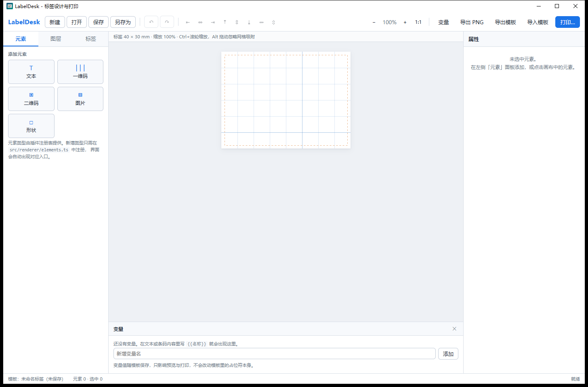

# LabelDesk · Windows 标签设计与热敏打印

> **这是一个自用程序，仅供参考。**
>
> 项目源于个人日常贴标签的需求（货架价签、商品标、资产标），代码按「自己用得住」的标准写，
> 没有做产品化打磨，也不保证适用于你的打印机与使用场景。
> 欢迎参考、借鉴或自行改造，但请**不要当作生产级软件使用**，作者不提供支持与维护承诺。
>
> 仓库：<https://github.com/xiaochengzina/LabelDesk>

一个 Windows 专用的标签设计与打印程序。用毫米为单位可视化设计标签，直连打印机（热敏标签机优先走原始指令），模板以 JSON 保存、可复用与分发。

开发与验证环境是一台 **Deli DL-888D** 热敏标签机（203dpi，TSPL 指令集），因此这个机型上的经验最多；其他机型请先看[已知限制](#已知限制)。



---

## 目录

- [它能做什么](#它能做什么)
- [环境要求](#环境要求)
- [快速开始](#快速开始)
- [打印通路说明](#打印通路说明)
- [条码支持与验证](#条码支持与验证)
- [模板文件格式](#模板文件格式)
- [扩展：新增元素类型](#扩展新增元素类型)
- [扩展：新增条码格式](#扩展新增条码格式)
- [开发与测试](#开发与测试)
- [已知限制](#已知限制)
- [目录结构](#目录结构)
- [许可与免责](#许可与免责)

---

## 它能做什么

- **可视化设计**：拖拽、八向缩放、旋转（Shift 吸附 15°）、网格吸附（Alt 临时关闭）、框选、多选、对齐与等距分布、图层管理、撤销/重做。
- **毫米为准**：所有几何以毫米描述，渲染时按打印机 DPI 换算，因此 203dpi / 300dpi 打印机与屏幕预览的**物理尺寸完全一致**。
- **两类打印通路**：
  - **Windows 驱动**：把位图按物理尺寸交给打印驱动，兼容任何打印机（包括 PDF / XPS 虚拟打印机）。
  - **原始指令**：直接把位图指令流写入打印队列，支持 **TSPL**（TSC、得力、佳博、汉印…）、**ESC/POS**、**ZPL**（Zebra），跳过驱动排版，热敏标签机最稳。
- **条码**：Code 128 / Code 39 / EAN-13 / EAN-8 / UPC-A / ITF-14，以及 QR 二维码（UTF-8，支持中文）。
- **变量占位符**：内容里写 `{{订单号}}`，打印前集中填值，一套版式反复用。
- **模板管理**：保存 / 另存 / 导入 / 导出，模板是可直接阅读和版本管理的 JSON。
- **位图二值化**：热敏纸只有黑白两态，渲染阶段即做阈值化，避免灰度抖动网点糊字。

---

## 环境要求

| 项目 | 要求 |
| --- | --- |
| 操作系统 | Windows 10 1809+ / Windows 11（x64） |
| 运行时 | WebView2 Runtime（Win11 自带；Win10 多数已随 Edge 安装） |
| 构建 | Node.js ≥ 20、Rust ≥ 1.77（MSVC 工具链）、Visual Studio Build Tools |

发布包为 NSIS 安装程序与 MSI，无需用户额外安装依赖。

---

## 快速开始

### 构建运行

```powershell
npm install                 # 安装前端依赖
npm run app:dev             # 开发模式（热重载）

npm run app:build           # 打包发布版（NSIS + MSI）
```

产物位于 `src-tauri/target/release/bundle/`。

### 设计并打印一张标签

1. 左侧「标签」页选择纸张规格（如 40 × 30 mm），或自定义尺寸。
2. 左侧「元素」页添加文本 / 一维码 / 二维码 / 图片 / 形状。
3. 画布上拖动摆位；右侧属性面板改内容、字号、条码格式等。
4. 点工具栏「打印…」，选择打印机与打印方式，点「打印」。
5. 保存后的模板可在「打开」里随时调出。

### 真机自检

不启动界面也能验证打印链路（会实际出纸）：

```powershell
cd src-tauri
cargo run --example print_test                         # 自动选第一台标签机，走原始指令
cargo run --example print_test -- "Deli DL-888D(NEW)" driver   # 指定打印机 + 驱动通路
```

它会打印一张 40×30mm 自检图案（外框、四角定位块、点阵数字、条码纹理、方阵），并复查打印队列是否被正常消化。

---

## 打印通路说明

### 原始指令（推荐用于热敏标签机）

位图在应用内渲染 → 二值化 → 打包成打印机能识别的指令流 → 直接写入打印队列（`winspool` RAW）。

用 TSPL 时下发的指令序列等价于：

```
INITIALPRINTER
SIZE 40.00 mm,30.00 mm
GAP 2.00 mm,0.00 mm
DIRECTION 0,0
REFERENCE 0,0
OFFSET 0 mm
SHIFT 0
DENSITY 8
SPEED 4
CLS
BITMAP 0,0,<宽字节数>,<高>,0,<位图数据>
PRINT 1,<份数>
```

几个容易踩的坑，程序已经处理：

- **位图宽度按字节对齐**：TSPL 的行宽以字节为单位，宽度不是 8 的倍数时右侧补白，否则整张会横向错位。
- **位极性**：TSC 手册规定 `0 = 打印`，但部分国产固件相反。打印全黑或全白时勾选「反转位极性」。
- **ESC/POS 分块**：`GS v 0` 单行上限 255 字节，超过时按列自动切块。
- **静区**：一维码两侧自动预留标准静区，避免扫码枪读不出。

### Windows 驱动

把二值化后的 PNG 交给 `resources/printer.ps1`，用 .NET `System.Drawing.Printing` 按**毫米对应的 1/100 英寸**播放，因此不受打印机 DPI 差异影响。多份通过多页循环实现，兼容性比 `PrinterSettings.Copies` 更好。

> 驱动通路依赖目标打印机已在 Windows 里配置好正确的标签尺寸与走纸方式。

---

## 条码支持与验证

条码是标签的核心，写错一个模块就扫不出来，因此本项目对每个格式都做了**真实解码验证**：

```powershell
node scripts/verify-1d.mjs     # 一维码：反向解码回原值
node scripts/verify-qr.mjs     # 二维码：交给真实解码器 jsQR 反解
```

| 格式 | 校验方式 | 结果 |
| --- | --- | --- |
| Code 128 | 反向解码（含 B/C 集切换、校验位） | 通过 |
| Code 39 | 反向解码（含 3 宽元素约束） | 通过 |
| EAN-13 / EAN-8 / UPC-A | 反向解码（校验位 + 奇偶模式） | 通过 |
| ITF-14 | 反向解码（含终止符） | 通过 |
| QR Code | jsQR 真实解码 | L 级 1–32 字节、M 级 1–106、Q 级 1–74、H 级 1–58 全部通过 |

### 二维码容量

| 纠错等级 | 最大内容 |
| --- | --- |
| L | 32 字节 |
| M | 106 字节 |
| Q | 74 字节 |
| H | 58 字节 |

超出容量时会**截断并给出明确告警**，而不是静默生成一个扫不出来的码。

---

## 模板文件格式

模板是纯 JSON，保存于 `%APPDATA%\com.labeldesk.app\layouts\<名称>.ldl.json`。

```jsonc
{
  "version": 1,
  "id": "商品价签",
  "name": "商品价签",
  "note": "货架用，40×30",
  "settings": {
    "widthMm": 40, "heightMm": 30,
    "gapMm": 2, "gapOffsetMm": 0,
    "gapMode": "gap",          // gap | bline | continuous
    "columns": 1,
    "marginMm": 1,
    "showGrid": true, "gridStepMm": 5
  },
  "elements": [
    {
      "id": "text-1", "kind": "text",
      "name": "品名", "xMm": 3, "yMm": 2, "widthMm": 34, "heightMm": 6,
      "rotation": 0, "locked": false, "visible": true, "opacity": 1,
      "text": "{{品名}}", "fontFamily": "sans", "fontSizePt": 10,
      "bold": true, "italic": false, "underline": false,
      "align": "left", "verticalAlign": "top",
      "lineHeight": 1.25, "letterSpacingPt": 0,
      "autoShrink": true, "clip": true
    },
    {
      "id": "barcode-1", "kind": "barcode",
      "name": "条码", "xMm": 3, "yMm": 9, "widthMm": 34, "heightMm": 14,
      "value": "{{条码}}", "format": "code128",
      "autoFit": true, "moduleWidthMm": 0.25, "barHeightRatio": 0.75,
      "showText": true, "showCheckDigit": true,
      "textSizePt": 7, "textGapMm": 0.8,
      "rotation": 0, "locked": false, "visible": true, "opacity": 1
    }
  ],
  "printer": {
    "name": "Deli DL-888D(NEW)",
    "channel": "raw",           // driver | raw
    "language": "tspl",         // tspl | escpos | zpl
    "dpi": 203, "density": 8, "speed": 4,
    "copies": 1, "threshold": 160, "invertBits": false
  },
  "variables": { "品名": "有机纯牛奶 250ml", "条码": "6901234567892" }
}
```

---

## 扩展：新增元素类型

扩展点集中在 `src/renderer/elements.ts`。新增一种元素只需三步，**不需要改动任何界面代码**——渲染、命中测试、属性面板、图层列表都由注册表驱动。

### 1) 在 `src/model/types.ts` 定义属性

```ts
export interface KeyValueProps {
  kind: "keyvalue";
  label: string;
  value: string;
  labelWidthMm: number;
  fontSizePt: number;
}

// 并入联合类型
export type LabelElement =
  | (BaseElement & TextProps)
  // …
  | (BaseElement & KeyValueProps);
```

### 2) 在 `elements.ts` 实现定义

```ts
const keyValueDef: ElementDefinition = {
  type: "keyvalue",
  label: "两列信息",
  icon: "≣",
  description: "左标题右内容的键值对",
  create: (partial = {}) => ({
    ...baseElement("keyvalue", "信息"),
    kind: "keyvalue",
    label: "规格",
    value: "250ml",
    labelWidthMm: 12,
    fontSizePt: 9,
    widthMm: 34,
    heightMm: 6,
    ...partial,
  }) as LabelElement,

  // 坐标原点已平移到元素左上角，并按 DPI 换算好毫米
  draw: (element, rc) => {
    if (element.kind !== "keyvalue") return;
    const { ctx } = rc;
    const size = ptToPx(element.fontSizePt, rc.dpi);
    const labelW = mmToPx(element.labelWidthMm, rc.dpi);
    ctx.font = `${size}px ${FONT_STACKS.sans}`;
    ctx.fillStyle = "#000";
    ctx.textBaseline = "middle";
    ctx.textAlign = "left";
    ctx.fillText(element.label, 0, mmToPx(element.heightMm, rc.dpi) / 2);
    ctx.font = `bold ${size}px ${FONT_STACKS.sans}`;
    ctx.fillText(element.value, labelW, mmToPx(element.heightMm, rc.dpi) / 2);
  },

  // 属性面板字段
  properties: [
    { key: "label", label: "标题", type: "text" },
    { key: "value", label: "内容", type: "text" },
    { key: "labelWidthMm", label: "标题列宽", type: "number", min: 4, max: 60, step: 0.5, unit: "mm" },
    { key: "fontSizePt", label: "字号", type: "number", min: 4, max: 40, step: 0.5, unit: "pt" },
  ],
};

registerElement(keyValueDef);
```

### 3) 完成

重新构建后，「元素」面板会自动出现「两列信息」入口；属性面板会依据 `properties` 生成对应控件；图层、撤销、打印、导出全部自动支持。

`properties` 支持的字段类型：`text` / `textarea` / `number` / `boolean` / `select` / `color` / `image`，并可用 `visibleWhen` 做条件显示。

---

## 扩展：新增条码格式

1. 在 `src/model/barcode.ts` 实现编码器，返回 `BarPattern { bars, widths, humanText, warnings }`。
2. 加进 `encodeBarcode()` 的分发与 `BarcodeKind` 类型。
3. 在 `elements.ts` 的 `BARCODE_FORMATS` 增加下拉项。
4. **在 `scripts/verify-1d.mjs` 加一条反向解码用例**——这是最关键的一步。

---

## 开发与测试

```powershell
npm run verify:all             # 一键跑完前端全部验证（类型检查 + 条码 + 变量 + DPI）
npm run build                  # 前端打包
npm run app:build              # 打包发布版（NSIS + MSI）

cd src-tauri
cargo test                     # Rust 单元测试（位图打包、TSPL/ESC-POS/ZPL 指令、PNG 编解码、模板存储）
cargo run --example print_test # 真机自检：合成图案走两条通路打印
cargo run --example print_image -- <png> <wPx> <hPx> <wMm> <hMm> [打印机]  # 打印任意 PNG
```

### 验证脚本

| 命令 | 作用 |
| --- | --- |
| `npm run verify:1d` | 一维码反向解码回读（Code128/39/EAN/UPC/ITF） |
| `npm run verify:qr` | 二维码交给真实解码器 jsQR 反解，逐长度扫描 |
| `npm run verify:variables` | 变量占位符替换（含中文变量名） |
| `npm run verify:dpi` | 同一模板在 203/300/600 dpi 下物理尺寸一致性 |
| `npm run verify:render` | 端到端：真实渲染器生成标签 PNG（加 `--print` 可真机打印） |
| `node scripts/selfcheck-qr.mjs` | 按规范读回 QR 数据位流，不依赖第三方实现 |

端到端验证会输出 `docs/e2e-label.png` 预览；加 `--print` 后走完整链路真机出纸：

```
== 端到端渲染验证 ==
模板：E2E 演示标签  50×40 mm
元素：6 个（shape, text, text, barcode, qrcode, text）
位图：400×320 px @ 203dpi
物理尺寸核对：50.05×40.04 mm
墨点占比：15.55%

== 真机打印 ==
TSPL：16173 字节，位图 320 行 × 50 字节/行，标签 50.00×40.00 mm
✔ 已向打印队列写入 16173 字节
✔ 打印队列已清空，作业已被打印机接收
```

Rust 侧打印相关的单元测试覆盖：

- `mono_to_row_bytes` 的位极性、补白、行对齐（补白不能污染同一字节内的真实像素）
- TSPL / ESC-POS / ZPL 指令流结构（含 ESC/POS 宽位图分块）
- 手写 PNG 编码器与解码器的往返一致性
- 模板存储的增删改查、重名导入、损坏文件容错、`..` 目录穿越防护

---

## 已知限制

自用程序，以下限制是**已知且未解决**的，使用前请确认你的场景不受影响。

### 未解决

| 限制 | 说明 |
| --- | --- |
| **QR 版本 > 6 不可用** | 版本 7 及以上的数据区编码有 bug。定位过程：功能图案、版本信息、校正图案、码字流、RS 纠错都已用独立参考实现逐字节核对**一致**，问题收窄到「矩阵位放置」，但未找到根因。当前按纠错等级收敛容量并给出告警。 |
| **L 级容量被压到 32 字节** | 纠错等级 L 从版本 3 起同样触发上述 bug，因此 L 级只开放版本 1–2。M/Q/H 三档可正常用到版本 6。 |
| **仅在我的机型上实测** | 只在 Deli DL-888D（TSPL）上做过真机验证。ESC/POS 与 ZPL 两条通路只做了指令流结构测试，**没有真机验证过**。 |

### 设计取舍

| 限制 | 说明 |
| --- | --- |
| 仅 Windows | 打印通路基于 `winspool.drv` 与 `System.Drawing.Printing`，这是刻意的平台限定。 |
| 驱动打印需要已配置纸张 | 走驱动时标签尺寸依赖打印机驱动里的纸张设置；原始指令通路不受此影响。 |
| 图片以 data URL 内嵌 | 模板里图片直接内嵌 base64，便于单文件分发；建议单张 ≤ 4MB 且使用纯黑白图。 |
| 不做多联排版 | `settings.columns` 字段已预留，当前版本一次只出一张标签。 |
| 无自动更新、无遥测 | 纯本地程序，不联网。 |

---

## 目录结构

```
LabelDesk/
├── src/                          # 前端（React + TypeScript）
│   ├── model/
│   │   ├── types.ts              # 数据模型（模板、元素、打印参数）
│   │   ├── units.ts              # 毫米/像素/磅换算与几何工具
│   │   └── barcode.ts            # 条码与二维码编码内核（零依赖）
│   ├── renderer/
│   │   ├── elements.ts           # ★ 元素注册表（扩展点）
│   │   ├── renderer.ts           # 画布渲染、命中测试、导出
│   │   └── images.ts             # 图片解码缓存
│   ├── state/store.ts            # 编辑器状态、撤销栈、对齐
│   ├── components/               # 画布、属性、图层、打印、模板、变量面板
│   ├── api/backend.ts            # Tauri 命令绑定
│   ├── App.tsx / main.tsx / styles.css
│   └── index.html
├── src-tauri/                    # 后端（Rust）
│   ├── src/
│   │   ├── lib.rs                # 命令注册与应用状态
│   │   ├── printers.rs           # 打印机枚举 + winspool RAW 打印
│   │   ├── print.rs              # 打印流水线、位图打包、TSPL/ESC-POS/ZPL
│   │   ├── store.rs              # 模板持久化（原子写、路径安全）
│   │   └── util.rs               # PNG 编解码、二值化、字节打包
│   ├── resources/printer.ps1     # 驱动打印辅助脚本（.NET 按物理尺寸播放）
│   ├── examples/
│   │   ├── print_test.rs         # 真机自检：合成图案走两条通路
│   │   └── print_image.rs        # 打印任意 PNG（端到端验证用）
│   └── icons/ capabilities/ Cargo.toml tauri.conf.json
├── scripts/                      # 验证脚本（不参与打包）
│   ├── verify-1d.mjs             # 一维码反向解码
│   ├── verify-qr.mjs             # 二维码 jsQR 解码
│   ├── verify-variables.mjs      # 变量替换
│   ├── verify-dpi.mjs            # DPI 无关性
│   ├── e2e-print.mjs             # 端到端渲染 + 可选真机打印
│   ├── selfcheck-qr.mjs          # QR 位流自检
│   ├── qr-reference.cjs          # QR 码字流参考实现（仅用于对照）
│   └── loader.mjs / loader-register.mjs  # Node ESM 解析钩子
└── docs/                         # 截图与端到端预览
```

---

## 许可与免责

MIT License。

**免责声明**：本项目为个人自用程序，仅供参考与学习交流，按「现状」提供，不附带任何明示或暗示的担保。作者不对以下情况负责：

- 因使用本程序造成的标签耗材浪费、打印设备损坏或业务损失；
- 条码/二维码在特定扫码设备上无法识别的风险（虽已做解码验证，但不同设备灵敏度有差异）；
- 模板数据丢失（模板保存于 `%APPDATA%\com.labeldesk.app\layouts\`，请自行备份）。

使用前请先用**少量标签纸试打**确认效果。
